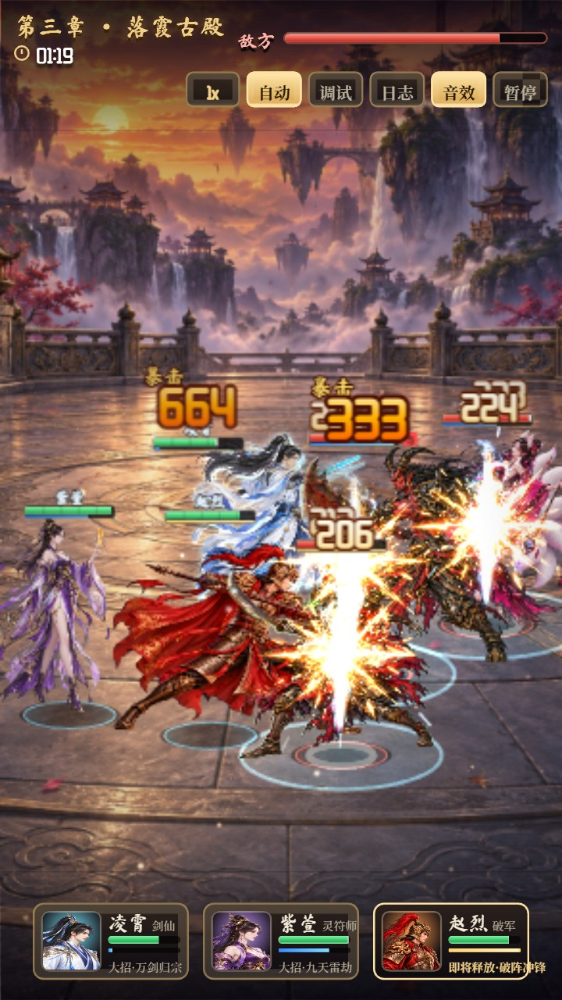
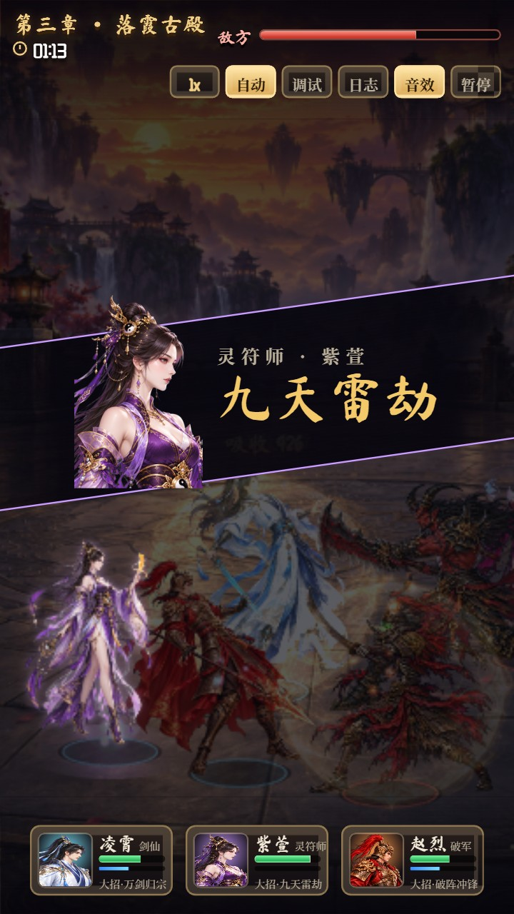
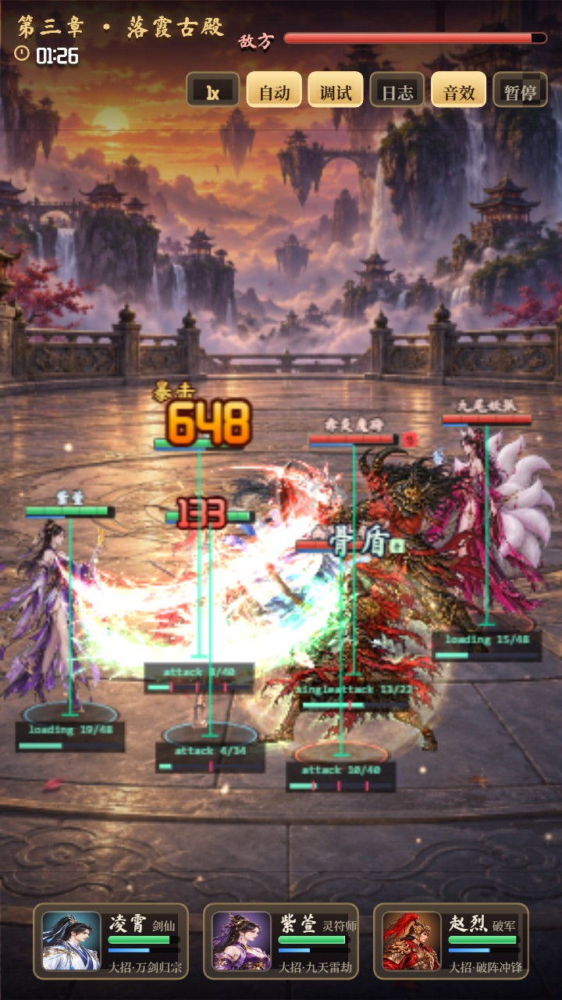
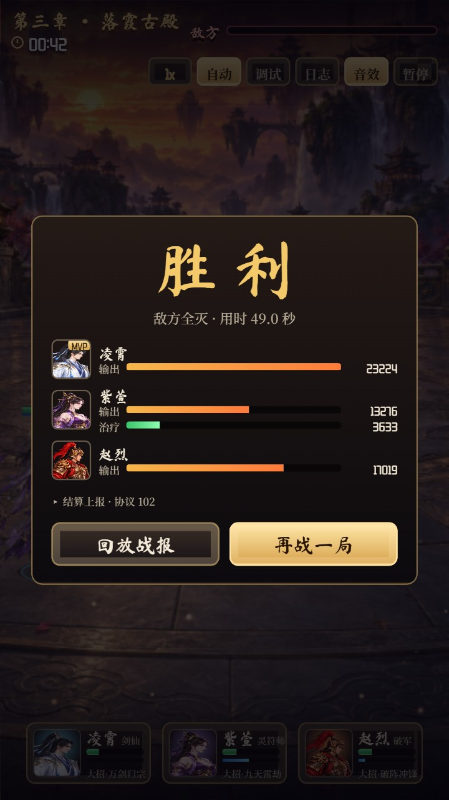

# 仙域争锋 · 战斗系统复刻 Demo

一个可以直接在浏览器里运行的 2D 即时战斗 Demo：3 对 3 自动战斗，竖屏手游布局。

重点在于完整复刻一套商业卡牌 RPG 的战斗架构：
- 组件化实体
- 帧事件驱动的攻击、技能和受击
- 大招演出
- 战报录制与回放

| 战斗 | 大招演出 | 调试叠加层 | 结算 |
|---|---|---|---|
|  |  |  |  |

## 运行

需要 Node.js 18 或更高版本，不需要 `npm install`。

```bash
npm start
```

浏览器打开 http://127.0.0.1:8090/ 即可。Windows 也可以直接双击 `start.bat`。

运行测试与数值统计：

```bash
npm test               # 战斗逻辑无头测试：确定性、战报回放一致性、帧事件命中时机等
npm run balance        # 跑 200 场统计胜率、时长、技能次数
```

## 玩法与界面

- 自动战斗。英雄怒气满时卡牌发光；关闭"自动"后，点击卡牌手动释放大招。
- 顶栏按钮：
  - **倍速**：1x / 2x / 0.5x / 0.25x，慢放时可以看清帧事件和受击反馈。
  - **调试**：在每个角色脚下显示当前动作、帧号，以及帧事件在时间轴上的位置。
  - **日志**：完整的战斗流水，可按 AI、状态、动画、帧事件、伤害、Buff、战报分类过滤。
- 结算界面：
  - 每个英雄的输出、治疗统计和 MVP。
  - 仿照协议 102 的结算上报数据。
  - "回放战报"按录制的战报重现整场战斗，不跑 AI、不算伤害，结果与原战斗完全一致。

## 角色与技能

| 角色 | 普攻 | 小技能 | 大招 |
|---|---|---|---|
| 剑仙·凌霄 | 流云剑 | 三叠浪（三段连斩） | 万剑归宗（全体五段飞剑） |
| 灵符师·紫萱 | 灵符弹（弹道） | 回春符（治疗 + 护盾） | 九天雷劫（全体雷击，概率眩晕） |
| 破军·赵烈 | 突刺（击退） | 燎原横扫（范围 + 灼烧） | 破阵冲锋（冲锋击飞） |
| 赤炎魔将 | 魔刃 | 狂魔连斩（自身狂怒） | 裂地斩（全体五段 + 地裂） |
| 九尾妖狐 | 狐火（弹道） | 狐火灼心（持续伤害） | 九尾魅影（全体，概率魅惑） |
| 幽冥骨卒 | 骨刃 | 骨盾连斩（自身护盾） | 冥骨葬（单体五段） |

## 目录

```
src/
  config/       配置层：角色、技能（逻辑 + 表现）、Buff、动作帧事件、震屏、常量
  fight/        逻辑层：FightWorld、实体与组件、伤害公式、目标选择、战报录制/回放
  view/         表现层：渲染、特效、粒子、飘字、镜头、程序化音效、素材加载
  ui/           DOM 界面：顶栏、卡牌、大招演出、结算、日志面板
  core/         事件总线、带种子随机数、缓动
assets/         角色姿势图、半身像、特效、背景（AI 生成后抠图处理）
tests/          无头测试与数值统计
tools/          素材生成（codex 内置生图 / OpenAI 图像接口）与后处理（抠图、透明化）
docs/           架构说明
```

架构细节见 [docs/ARCHITECTURE.md](docs/ARCHITECTURE.md)，包括：
- 一次攻击从 AI 选技能到目标受击的完整调用链
- 动作配置与帧事件
- 状态机切换规则
- 战报格式

## 素材

所有美术都是原创 AI 生成，风格为国风仙侠厚涂：
- 生成：`tools/gen_with_codex.py`，调用本机 codex CLI 的内置图像生成。也可以改用 `tools/gen_assets.py`，直接调 OpenAI 图像接口。
- 后处理：`tools/postprocess.py`
  - 角色：品红底全局抠图，边缘去溢色
  - 特效：黑底转"亮度即透明度"，用于叠加混合
- 姿势一致性：每个角色先生成待机图，再以待机图为参考生成出招、蓄力、受击姿势和半身像，保证同一角色造型一致。

缺少某张素材时，渲染层会自动降级：缺少姿势图时用待机图，缺少半身像时从待机图裁头像，缺少角色图时画剪影占位。

## 说明

本项目参考了一款商业 Egret 小游戏战斗系统的架构设计，只借鉴了组织方式和数据设计思路，用于学习研究。

**未包含、也未使用原游戏的任何代码、美术、音频或配置数据。**
